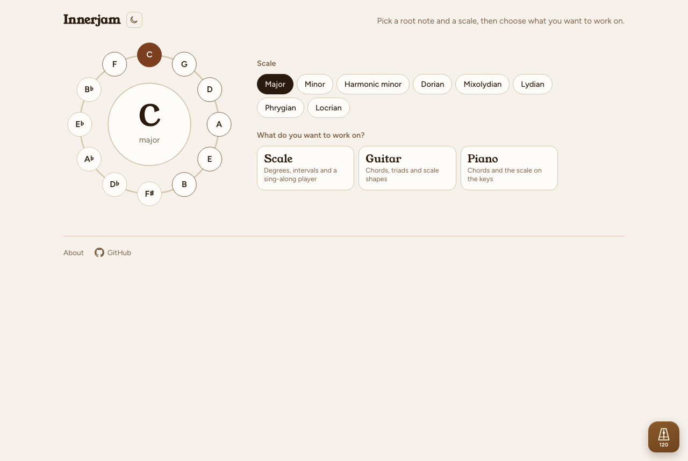

# Innerjam

**A songwriter's jam tool.** Pick a root note and a scale, then explore diatonic chords, fretboard shapes and scale diagrams — and play along with the built-in sequencers and progression looper.

🎵 **Live at [jam.reesh.online](https://jam.reesh.online)**



---

## What it does

- **Circle of fifths** key picker — tap any note, spin the wheel for variety
- **8 scales** — Major, Minor, Harmonic minor, Dorian, Mixolydian, Lydian, Phrygian, Locrian
- **Scale panel** — degree tiles, intervals, W/H step pattern, sing-along sequencer with transposing rounds
- **Guitar panel** — chord voicings (open, E-shape, A-shape barre), triads on any string group, 3-notes-per-string scale shapes; strum or fingerpick mode
- **Piano panel** — chord diagrams and a 2-octave scale keyboard with a player
- **Chord sizes** — Triads, 7ths, 9ths, 13ths; mix sizes freely in the progression looper
- **Progression looper** — build a loop from any chords across any size tier, load presets, set tempo and beats-per-chord
- **Wooden metronome** — floating button, 4/4 woodblock click, 40–220 BPM, pendulum animation
- **Light / dark toggle** — brown-and-white light theme; remembers your preference

## Tech

Single HTML file — no build step, no framework, no dependencies. Web Audio API for all sound synthesis (Karplus-Strong guitar, triangle+sine piano, filtered-noise woodblock). Deployed as a static site via GitHub Pages.

## Run locally

```bash
# any static server works — here are two options:
npx browser-sync start --server . --files "index.html" --port 8787
# or
python3 -m http.server 8787
```

Then open `http://localhost:8787`.

## Contribute

Issues and PRs welcome. The entire app lives in `index.html` — see `CLAUDE.md` for a full code map, design conventions and testing notes.
